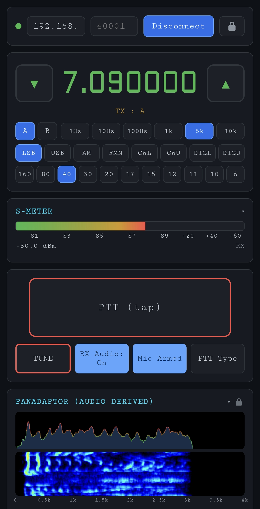
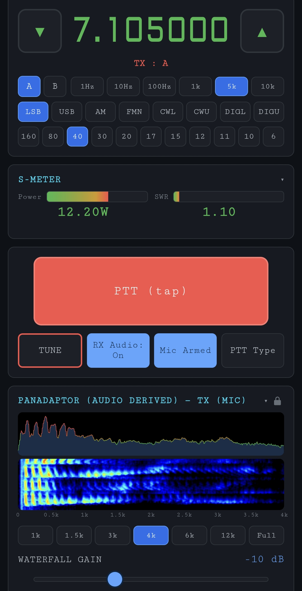
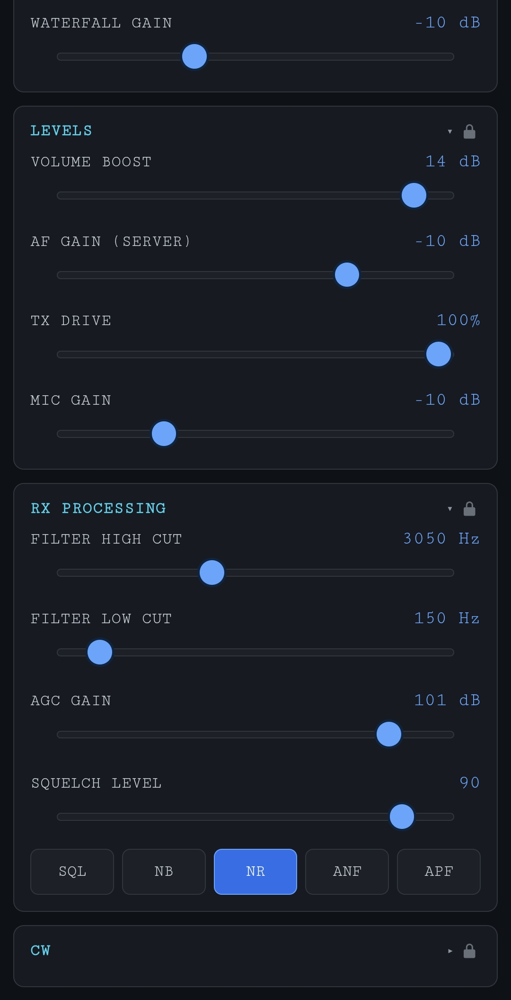
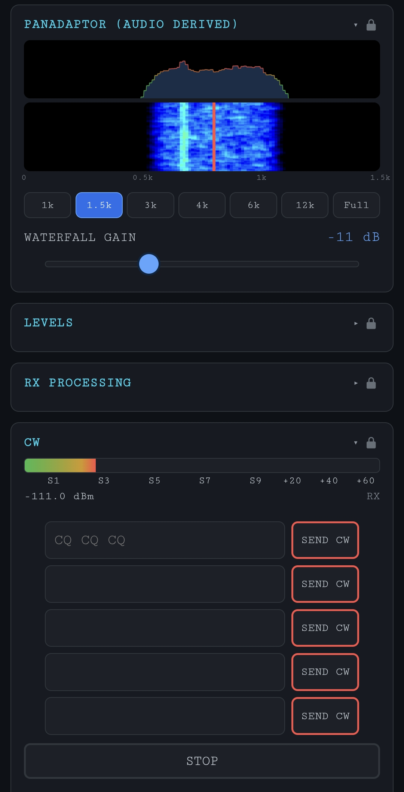
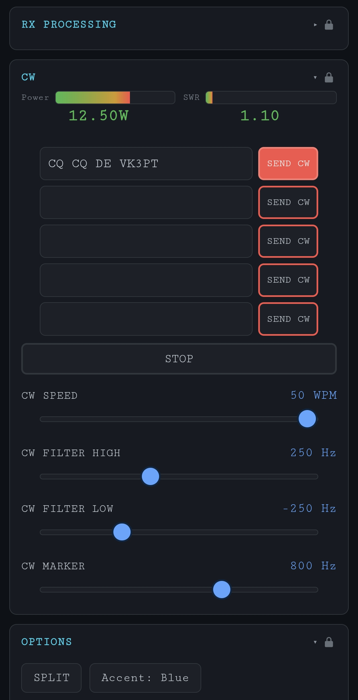
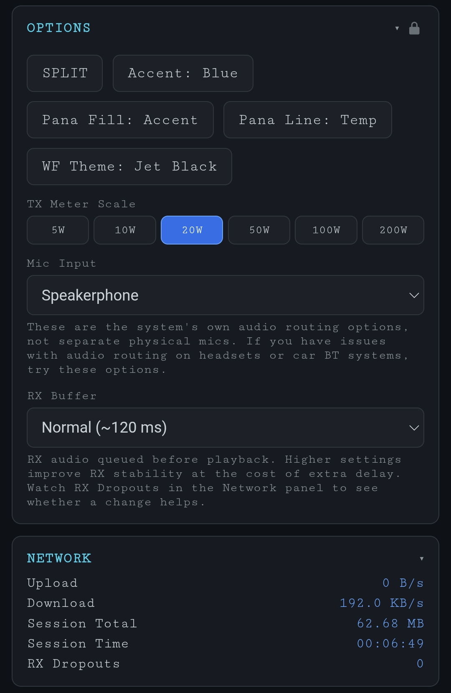

  

# piHPSDR TCI Remote

A web app for operating [piHPSDR](https://github.com/dl1ycf/pihpsdr), the SDR program by DL1YCF, remotely from a phone, tablet or computer, using piHPSDR's built-in TCI server. It is a single HTML file with no dependencies, plus an Android APK that wraps the same page for easy installation.

This is an independent project. It is not affiliated with piHPSDR or Expert Electronics.

  
  
  
  
  
  

## What it is for

piHPSDR's TCI server is designed for programs running on the same network as the radio, such as logging and digital-mode software. This app uses the same interface as a remote operating panel: you can listen to the receiver, tune, change mode and filters, and transmit by voice or CW from a phone or another computer, over your home network or a VPN.

Using TCI this way is outside what it was designed for. The app works around the differences (audio buffering, bandwidth, reconnecting). In the author's use, and for a small group of other users, it has worked well over home broadband and mobile data. Results depend on the quality of your network connection.

TCI is not a lightweight protocol: it carries uncompressed 48 kHz, 32-bit float audio in both directions. In DL1YCF's piHPSDR, support for a mono RX audio channel lets this app halve the receive bandwidth. Transmit audio is stereo and is not reduced. See [Bandwidth](#bandwidth).

It is written specifically for piHPSDR by DL1YCF, using the TCI commands piHPSDR provides, and has been developed and tested only against it. It might work with other TCI-compatible servers, but that has not been tested, and some behaviour (mono RX audio, for example) needs support in the server. The code is open source so that anyone can experiment with it or develop it further.

## Requirements

- piHPSDR with the TCI server enabled (it listens on port 40001 by default). [TODO: minimum piHPSDR version, once the TCI audio changes are merged]
- A device on the same network as piHPSDR, or connected to it through a VPN:
  - an Android phone or tablet, Android 7.0 or later, using the APK; or
  - a computer with a modern browser, opening the HTML file; or
  - an iOS device running the HTML file inside an independent WebView wrapper app (untested).
- A microphone, to transmit voice.

Developed and tested with an ANAN-10E and a Hermes Lite 2, using piHPSDR 3.1 builds (TEST branch, commit 6ce76a30). Earlier piHPSDR versions have not been verified. [TODO: tested browsers and phones]

## Installing

### Android (APK)

1. Download the APK from the Releases page. [Releases](https://github.com/vk3pt/piHPSDR-TCI-Remote/releases)
2. Allow installation from unknown sources when Android asks, and install it.
3. Grant the microphone permission when you first arm TX Audio.
4. For uninterrupted listening with the screen off, set the app's battery usage to "Unrestricted" (this process varies slightly by phone).

### Browser (HTML file)

1. Download the HTML file from the Releases page. [Releases](https://github.com/vk3pt/piHPSDR-TCI-Remote/releases)
2. Open it in your browser from your device's storage.

Notes:
- Keep the same filename and location when you update. Some browsers (Firefox, for example) tie saved settings to the file's path, so moving or renaming it makes your settings appear to reset.
- The page cannot be served from an HTTPS website. It connects with plain `ws://`, which browsers block from HTTPS pages.
- On Android, use the APK. Browsers there may block microphone access to a local file.

### Connecting

Enter the IP address (or host name) of the computer running piHPSDR with TCI enabled, and the TCI port (default 40001), then press Connect. RX audio starts automatically. The app remembers the last address.

## Remote access: use a VPN

> [!WARNING]
> **Do not open or forward ports on your router for this app, and do not expose the TCI port to the internet.** The TCI protocol has no authentication or encryption, so anyone who can reach the port can control your radio, including transmitting. For remote use, put your devices on a VPN. Tailscale is recommended (a free tier is available for personal use; check its current terms).

Tailscale is an easy option for anyone who does not already have a VPN:

1. Install Tailscale on the computer running piHPSDR and on your phone or tablet, and sign in to the same account on both.
2. In the Tailscale app, note the computer's Tailscale address (100.x.y.z) or its MagicDNS name.
3. In this app, enter that address as the host and 40001 as the port.

Tailscale encrypts traffic between your devices. Any other VPN that puts both devices on one private network (WireGuard, ZeroTier and others) works the same way.

## Features

### Tuning and modes
- VFO A and B selection, and SPLIT.
- Frequency up and down buttons: a tap moves one step; holding for more than 1.5 s repeats every 200 ms. The mouse wheel works over the frequency display.
- Steps: 1 Hz, 10 Hz, 100 Hz, 1 kHz, 5 kHz, 10 kHz.
- Modes: LSB, USB, AM, FMN, CWL, CWU, DIGL, DIGU.
- Band buttons for 160, 80, 40, 30, 20, 17, 15, 12, 11, 10 and 6 m. Each band remembers its last frequency, mode and step.
- It controls the first receiver only (receiver 0).

### Receive audio
- RX audio is requested as mono, 48 kHz, 32-bit float, which halves the downstream bandwidth compared with stereo (if the server supports it; otherwise stereo is used). Thanks to DL1YCF for his assistance with this feature.
- AF Gain (Server) sets piHPSDR's volume (-40 to 0 dB). Volume Boost (0 to 15 dB) is extra gain applied on the device only.
- RX Buffer: Low (about 80 ms), Normal (about 120 ms, the default), High (about 250 ms) or Max (about 400 ms). A larger buffer rides out network jitter at the cost of extra delay.
- An RX Dropouts counter in the Network panel counts occasions when the buffer ran dry.
- If no RX audio arrives for 2 s, the connection is closed and reopened automatically (up to 3 attempts).

### Transmit
- PTT has three types, selected with the PTT Type button: Tap (toggle), Hold, and Off (receive-only lock). TUNE follows the same Hold/Toggle setting and uses the current TX Drive.
- TX Audio arms the microphone (the button then reads "Mic Armed"). A Mic Input option pins capture to a specific audio input. Mic gain (-20 to +20 dB) is remembered per mode. TX Drive is 0 to 100.
- When PTT is pressed, RX audio is muted immediately, buffered microphone samples are discarded, and the first 200 ms of microphone audio is silenced. This keeps residual RX audio from being transmitted.
- The TX meter shows power and SWR. Its scale can be set to 5, 10, 20, 50, 100 or 200 W.
- The microphone is released when the app is sent to the background, and re-armed when you return to it, where the platform allows.
- The main PTT button is disabled in CW modes. Space bar = PTT on a computer.

### CW
- Five message slots, stored on the device, with SEND and STOP buttons.
- Speed 5 to 50 WPM, and CW filter low and high sliders.
- A CW marker draws a reference line on the waterfall (400 to 1000 Hz). It is local to the app and is not sent to piHPSDR.
- CW is sent as a TCI text macro that piHPSDR keys itself, so it does not use the microphone.

### Receiver controls
- NB, NR, ANF and APF on/off buttons. NR is on/off only; the NR type is chosen by piHPSDR.
- Squelch on/off and level.
- AGC gain slider (-20 to 120).
- Filter high-cut and low-cut sliders, remembered per mode.

### Display
- S-meter (S1 to S9 and above), which switches to power and SWR during transmit.
- Panadapter and waterfall, computed from the received audio (labelled "Audio Derived" in the app). piHPSDR's TCI carries no IQ data, so a true RF waterfall is not possible. The display is derived from the audio instead, so it shows the audio passband, not the RF spectrum. During transmit it shows the microphone audio.
  - Zoom presets: 1, 1.5, 3, 4, 6 and 12 kHz, and Full (24 kHz), remembered per mode.
  - Waterfall palettes: Classic, Jet, Jet Black, Fire, Viridis, Grayscale. Waterfall gain -30 to +30 dB.
  - Fill: Off, Accent, Green, Blue, Temp, Temp 2, WF Theme. Line: Accent, Green, Blue, Yellow, Red, White, Temp.
- Blue or green accent theme.

### Interface
- Single-column layout for phones.
- Panels can be collapsed. Each panel has a lock icon, and a global lock prevents accidental changes. Connection, VFO, PTT and TUNE stay usable while locked; the global lock also locks the RX Audio, TX Audio and PTT Type buttons.
- Log panel for connection and audio events.
- Network panel: upload and download rates, session total, session time and RX dropouts.
- Settings are saved in the browser's local storage on the device (not sent anywhere): connection address, band memory, per-mode filters, zoom and mic gain, audio levels, themes, locks, PTT type, CW messages, squelch and RX buffer. There is no settings export or import.

## Bandwidth

| Direction | Audio | Approximate rate |
|---|---|---|
| Receive (download) | mono, 48 kHz, 32-bit float | 192 kB/s (1.5 Mbit/s), about 0.7 GB per hour |
| Transmit (upload) | stereo, 48 kHz, 32-bit float | 384 kB/s (3.1 Mbit/s), about 1.4 GB per hour of transmitting |

Control traffic and frame headers add a little more. Allow for this on metered mobile data.

Mono RX audio needs a piHPSDR version that supports it, and the app requests it automatically. With a server that does not, RX audio arrives as stereo, at about 384 kB/s.

## Limitations

- TCI was not designed for remote operation, and it is not a lightweight protocol (see Bandwidth). Latency and audio quality depend on your network, and a poor connection will cause audio dropouts. The RX Buffer setting helps with receive; there is no equivalent for transmit.
- Only one client at a time should have RX audio enabled. Newer piHPSDR builds enforce this per receiver. If another program (WSJT-X, for example) is using TCI audio, turn off RX Audio in this app.
- Android may suspend or stop the app in the background (check your device's battery optimisation settings). The microphone is released when the app is backgrounded, so you can listen in the background but not transmit.
- iOS is not directly supported (feel free to take the HTML and create an app yourself).
- The app has no authentication of its own (see Remote access above).
- What happens if the connection drops during transmit is determined by piHPSDR, not this app. Test it on your setup before relying on it.
- Remote operation is subject to the conditions of your licence, where applicable.

## How it works

- One HTML file connects to piHPSDR over a WebSocket (`ws://host:port`) and speaks TCI: text commands plus binary audio frames (a 64-byte header followed by 32-bit float samples).
- RX audio frame sizes are taken from the bytes actually received, not from the header's length field. TX replies are sized from each TX chrono request the server sends, and sent in step with those requests.
- Microphone capture uses an AudioWorklet. The panadapter and waterfall use an FFT of the audio.
- TCI commands used: `audio_start`, `audio_stop`, `audio_stream_channels`, `agc_gain`, `cw_keyer_speed`, `cw_macros`, `cw_macros_stop`, `drive`, `modulation`, `rx_anf_enable`, `rx_apf_enable`, `rx_filter_band`, `rx_nb_enable`, `rx_nr_enable`, `rx_sensors_enable`, `split_enable`, `sql_enable`, `sql_level`, `trx`, `tune`, `tx_sensors_enable`, `vfo`, `volume`.
- The page makes no network connection other than the WebSocket to the address you enter, and contains no analytics. There is no build step: edit the HTML file and open it.

## About the APK

The APK was built with AppMint, a commercial tool that wraps a web page in an Android WebView. It contains the same HTML file.

- The microphone is the only permission that prompts you. The APK also declares network, vibrate, legacy storage (Android 9 and below) and launcher-badge permissions. They come from the wrapper template and are not used by this app.
- The wrapper includes third-party libraries that this app does not use.
- Android installs an update over an existing install only if it is signed with the same key, and keeps your settings in that case. Signing certificate SHA-256: `36:EE:BE:3F:1E:78:E5:A3:ED:9C:3B:4E:50:57:01:1B:C4:55:8C:70:0B:89:E7:E9:FF:EA:4A:CB:DE:CA:4C:D5`
- APK SHA-256: [TODO: fill in for the release being published]

## Licence

GPL-3.0-or-later. Copyright (C) 2026 VK3PT. See `LICENSE`.

- The embedded font is a subset of Aldrich, copyright Matthew Desmond 2011, used under the SIL Open Font License 1.1. It remains under that licence.
- The APK also contains wrapper components that have their own licences and terms.
- piHPSDR is a separate project with its own licence. "piHPSDR" and "TCI" are used only to identify what this app works with.

## Credits

piHPSDR is by DL1YCF (C. van Wüllen) and contributors. The TCI details used here were provided by DL1YCF. TCI is a protocol from Expert Electronics.

73, VK3PT
